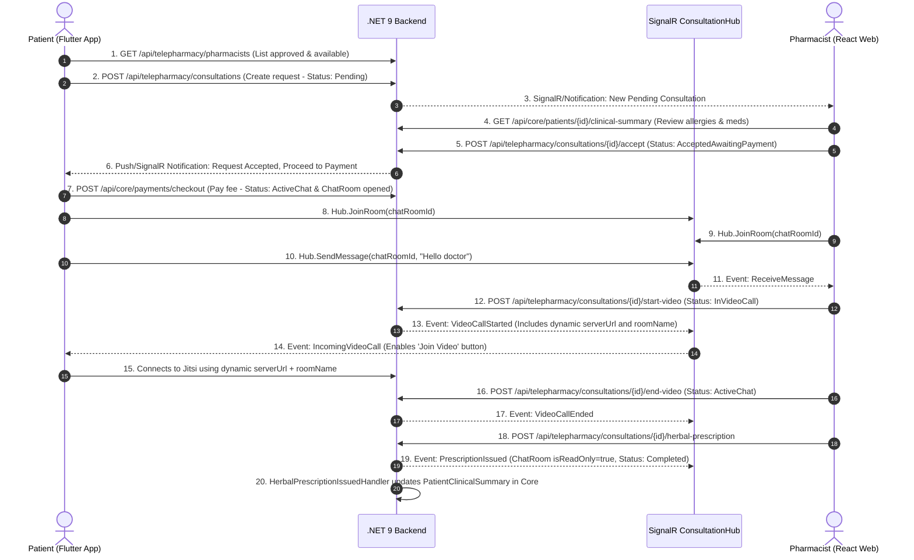

# Healthcare ERP - Frontend and Mobile API Integration Guide

This guide details the integration contract for the React Web Application (Pharmacist and Hospital SaaS Portal) and the Flutter Mobile Application (Unified Patient Application).

---

## 1. Connection and Authentication Specifications

### 1.1 Base URLs

| Environment | Base URL | SignalR Hub URL |
|---|---|---|
| Development (Local) | `http://localhost:5000` or `https://localhost:5001` | `ws://localhost:5000/hubs/consultation` |
| Swagger UI (Development) | `http://localhost:5000/swagger` (Root `/` redirects to `/swagger`) | N/A |
| OpenAPI JSON Specification | `http://localhost:5000/swagger/v1/swagger.json` | N/A |
| Staging / Production | Defined per deployment environment | Defined per deployment environment |

> [!NOTE]
> Frontend (React) and Mobile (Flutter) teams can import `http://localhost:5000/swagger/v1/swagger.json` into client code generators (such as `openapi-generator`, `orval`, or `swagger_dart_codegen`) to automatically scaffold strongly-typed DTOs, API clients, and enums.

### 1.2 Development Seeded Accounts

The development database seeds the following verified accounts upon initial startup:

| Role | Email | Password | Identifier Details |
|---|---|---|---|
| Pharmacist | `pharmacist@erp.local` | `Password123!` | UserId: `22222222-2222-2222-2222-222222222222`<br/>ProfileId: `55555555-5555-5555-5555-555555555555`<br/>TenantId: `11111111-1111-1111-1111-111111111111`<br/>Specialization: `HerbalAndComplementaryMedicine`<br/>Fee: `150.00 EGP`<br/>Status: `Approved`, `Available` |
| Patient | `patient@erp.local` | `Password123!` | UserId: `33333333-3333-3333-3333-333333333333`<br/>PatientId: `44444444-4444-4444-4444-444444444444`<br/>NationalId: `29001011234567`<br/>Gender: `Male`, BloodType: `APositive` |

### 1.3 HTTP Authorization Header Format

All endpoints except registration and login require an authorization header containing the Bearer JWT:

```http
Authorization: Bearer <token>
```

For SignalR WebSockets, the token is supplied via the query string:
`ws://localhost:5000/hubs/consultation?access_token=<token>`

---

## 2. Complete Enum String Values Reference

All enums are serialized as strings in JSON payloads. Integer values are also accepted by the backend during deserialization.

| Enum Type | Allowed String Values | Description |
|---|---|---|
| `Gender` | `"Male"`, `"Female"` | Biological sex of patient |
| `BloodType` | `"APositive"`, `"ANegative"`, `"BPositive"`, `"BNegative"`, `"ABPositive"`, `"ABNegative"`, `"OPositive"`, `"ONegative"`, `"Unknown"` | ABO and Rh blood group |
| `PharmacistSpecialization` | `"ClinicalPharmacy"`, `"HerbalAndComplementaryMedicine"` | Pharmacist clinical domain |
| `VerificationStatus` | `"PendingReview"`, `"Approved"`, `"Rejected"`, `"Suspended"` | Pharmacist license status |
| `ConsultationStatus` | `"Pending"`, `"Rejected"`, `"Expired"`, `"AcceptedAwaitingPayment"`, `"ActiveChat"`, `"InVideoCall"`, `"Completed"` | Consultation state machine lifecycle |
| `ChatSenderRole` | `"Patient"`, `"Pharmacist"`, `"System"` | Identity role of chat message sender |
| `ChatMessageType` | `"Text"`, `"ImageAttachment"`, `"LabReportPdf"`, `"SystemNotice"` | Chat message category |
| `VideoProviderType` | `"Jitsi"`, `"Agora"`, `"CustomWebRtc"` | WebRTC infrastructure provider |
| `VideoSessionStatus` | `"Ringing"`, `"Active"`, `"Ended"`, `"Missed"` | Video call state |
| `UserRole` | `"SuperAdmin"`, `"TenantAdmin"`, `"Doctor"`, `"Pharmacist"`, `"Nurse"`, `"Patient"` | IAM role |
| `PaymentStatus` | `"Pending"`, `"Paid"`, `"Failed"`, `"Refunded"` | Financial transaction status |

---

## 3. REST API Reference

### 3.1 Authentication Module (`/api/core/auth`)

#### `POST /api/core/auth/register-patient`
Registers a new patient profile and returns an authentication token.

- Request Body:
```json
{
  "email": "sarah.patient@example.com",
  "phoneNumber": "+201012345678",
  "password": "Password123!",
  "fullName": "Sarah Ali",
  "nationalId": "29801011234568",
  "dateOfBirth": "1998-05-20",
  "gender": "Female",
  "bloodType": "OPositive",
  "weightKg": 62.5,
  "heightCm": 168.0,
  "emergencyContactName": "Ali Hassan",
  "emergencyContactPhone": "+201087654321"
}
```

- Response `200 OK`:
```json
{
  "token": "eyJhbGciOiJIUzI1NiIsInR5cCI6IkpXVCJ9...",
  "userId": "9b1deb4d-3b7d-4bad-9bdd-2b0d7b3dcb6d",
  "patientId": "c56a4180-65aa-42ec-a945-5fd21dec0538",
  "role": "Patient"
}
```

- Error `409 Conflict`:
```json
{
  "message": "Email already registered."
}
```

---

#### `POST /api/core/auth/register-pharmacist`
Registers a new pharmacist user account.

- Request Body:
```json
{
  "email": "dr.kareem@example.com",
  "phoneNumber": "+201098765432",
  "password": "Password123!",
  "fullName": "Dr. Kareem Tarek",
  "tenantId": null
}
```

- Response `200 OK`:
```json
{
  "token": "eyJhbGciOiJIUzI1NiIsInR5cCI6IkpXVCJ9...",
  "userId": "283f5860-26cd-4d80-8777-a8a439366d48",
  "role": "Pharmacist",
  "tenantId": null
}
```

---

#### `POST /api/core/auth/login`
Authenticates a user via email or phone number.

- Request Body:
```json
{
  "emailOrPhone": "patient@erp.local",
  "password": "Password123!"
}
```

- Response `200 OK`:
```json
{
  "token": "eyJhbGciOiJIUzI1NiIsInR5cCI6IkpXVCJ9...",
  "userId": "33333333-3333-3333-3333-333333333333",
  "role": "Patient",
  "tenantId": null,
  "patientId": "44444444-4444-4444-4444-444444444444"
}
```

---

### 3.2 Patient & Clinical Summary Module (`/api/core/patients`)

#### `GET /api/core/patients/me/clinical-summary`
Retrieves the logged-in patient profile and clinical summary (Allergies, Chronic Conditions, Medications).

- Headers: `Authorization: Bearer <Patient_JWT>`
- Response `200 OK`:
```json
{
  "patient": {
    "id": "44444444-4444-4444-4444-444444444444",
    "userId": "33333333-3333-3333-3333-333333333333",
    "fullName": "Ahmed Mahmoud",
    "email": "patient@erp.local",
    "nationalId": "29001011234567",
    "dateOfBirth": "1990-01-01",
    "gender": "Male",
    "bloodType": "APositive",
    "weightKg": 75.5,
    "heightCm": 178.0,
    "emergencyContactName": "Mona Mahmoud",
    "emergencyContactPhone": "+201000000003"
  },
  "clinicalSummary": {
    "id": "771b9e22-8356-4221-872e-c15bc5eb2412",
    "patientId": "44444444-4444-4444-4444-444444444444",
    "allergiesJson": "[\"Penicillin\", \"Sulfa Drugs\"]",
    "chronicConditionsJson": "[\"Mild Hypertension\"]",
    "activeMedicationsJson": "[\"Amlodipine 5mg daily\"]",
    "activeHerbalPrescriptionsJson": "[]",
    "majorSurgeriesJson": "[\"Appendectomy (2018)\"]",
    "lastUpdatedAtUtc": "2026-10-20T10:00:00Z"
  }
}
```

---

#### `PUT /api/core/patients/me/clinical-summary`
Updates the patient clinical summary. Guard check enforces valid JSON arrays on all fields.

- Headers: `Authorization: Bearer <Patient_JWT>`
- Request Body:
```json
{
  "allergiesJson": "[\"Penicillin\", \"Peanuts\"]",
  "chronicConditionsJson": "[\"Mild Hypertension\"]",
  "activeMedicationsJson": "[\"Amlodipine 5mg daily\"]",
  "majorSurgeriesJson": "[\"Appendectomy (2018)\"]",
  "activeHerbalPrescriptionsJson": null
}
```

- Response `200 OK`:
```json
{
  "id": "771b9e22-8356-4221-872e-c15bc5eb2412",
  "patientId": "44444444-4444-4444-4444-444444444444",
  "allergiesJson": "[\"Penicillin\", \"Peanuts\"]",
  "chronicConditionsJson": "[\"Mild Hypertension\"]",
  "activeMedicationsJson": "[\"Amlodipine 5mg daily\"]",
  "activeHerbalPrescriptionsJson": "[]",
  "majorSurgeriesJson": "[\"Appendectomy (2018)\"]",
  "lastUpdatedAtUtc": "2026-10-20T10:05:00Z"
}
```

---

#### `GET /api/core/patients/{patientId}/clinical-summary`
Allows clinical staff (Pharmacist, Doctor) to inspect a patient's summary. Every read access logs an audit record with `AuditActionType.AccessClinicalSummary`.

- Headers: `Authorization: Bearer <Pharmacist_JWT>`
- Response `200 OK`: Matches `PatientClinicalSummaryDetailResponse`.

---

### 3.3 Payments Module (`/api/core/payments`)

#### `POST /api/core/payments/checkout` (or `/api/core/payments/mock-pay`)
Processes consultation fee payment. Verifies the consultation is in `AcceptedAwaitingPayment`, triggers `ConsultationPaidIntegrationEvent` to open the `ChatRoom`, and records the payment.

- Headers: `Authorization: Bearer <Patient_JWT>`
- Request Body:
```json
{
  "consultationId": "8f81ef69-b5c5-497d-a193-4e4cf0424567",
  "amount": 150.00,
  "currency": "EGP"
}
```

- Response `200 OK`:
```json
{
  "paymentId": "50e4ca24-a714-4114-8f0a-7b3b4d4715f3",
  "status": "Paid",
  "gatewayTransactionId": "mock_tx_50e4ca24a71441148f0a7b3b4d4715f3"
}
```

- Error `409 Conflict` (If consultation not in `AcceptedAwaitingPayment`):
```json
{
  "message": "Consultation 8f81ef69-b5c5-497d-a193-4e4cf0424567 is not in the AcceptedAwaitingPayment state (current: Pending)."
}
```

---

### 3.4 Herbs Catalog Module (`/api/telepharmacy/herbs`)

#### `GET /api/telepharmacy/herbs`
Returns a paginated list of approved medicinal herbs.

- Query Parameters: `pageNumber=1`, `pageSize=20`, `search=ginger`, `isApprovedForPrescription=true`
- Response `200 OK`:
```json
{
  "items": [
    {
      "id": "18f50442-9ee6-4e5a-8b1b-ef4aa6e1d752",
      "scientificName": "Zingiber officinale",
      "arabicCommonName": "زنجبيل",
      "englishCommonName": "Ginger",
      "activeIngredients": "[\"6-Gingerol\", \"6-Shogaol\"]",
      "contraindicationsJson": "[\"Gallstones\", \"Concurrent anticoagulant medication use\"]",
      "standardPreparationForms": "Infusion, Decoction, Capsule, Powder",
      "isApprovedForPrescription": true
    }
  ],
  "pageNumber": 1,
  "pageSize": 20,
  "totalCount": 1,
  "totalPages": 1,
  "hasPreviousPage": false,
  "hasNextPage": false
}
```

---

### 3.5 Pharmacist Profiles Module (`/api/telepharmacy/pharmacists`)

#### `GET /api/telepharmacy/pharmacists`
Returns paginated list of verified and available pharmacists for patient booking.

- Query Parameters: `pageNumber=1`, `pageSize=10`, `specialization=HerbalAndComplementaryMedicine`
- Response `200 OK`:
```json
{
  "items": [
    {
      "id": "55555555-5555-5555-5555-555555555555",
      "userId": "22222222-2222-2222-2222-222222222222",
      "tenantId": "11111111-1111-1111-1111-111111111111",
      "syndicateLicenseNumber": "PHARM-EG-2026-9876",
      "licenseDocumentUrl": "https://storage.greenlife.local/licenses/pharm-9876.pdf",
      "verificationStatus": "Approved",
      "specialization": "HerbalAndComplementaryMedicine",
      "bio": "Licensed clinical pharmacist specializing in herbal pharmacology, natural remedies, and drug-herb interactions.",
      "consultationFee": 150.00,
      "isAvailableForRequests": true,
      "verifiedAtUtc": "2026-10-17T09:00:00Z"
    }
  ],
  "pageNumber": 1,
  "pageSize": 10,
  "totalCount": 1,
  "totalPages": 1,
  "hasPreviousPage": false,
  "hasNextPage": false
}
```

---

#### `PUT /api/telepharmacy/pharmacists/me/availability`
Toggles pharmacist online availability for incoming requests.

- Headers: `Authorization: Bearer <Pharmacist_JWT>`
- Request Body:
```json
{
  "isAvailable": true
}
```

- Response `200 OK`:
```json
{
  "pharmacistProfileId": "55555555-5555-5555-5555-555555555555",
  "isAvailableForRequests": true,
  "verificationStatus": "Approved"
}
```

---

### 3.6 Consultations Module (`/api/telepharmacy/consultations`)

#### `POST /api/telepharmacy/consultations`
Patient submits a consultation request to a specific pharmacist.

- Headers: `Authorization: Bearer <Patient_JWT>`
- Request Body:
```json
{
  "pharmacistProfileId": "55555555-5555-5555-5555-555555555555",
  "chiefComplaintAndSymptoms": "Persistent migraines and difficulty sleeping.",
  "clinicalSummaryConsentGranted": true,
  "durationHours": 24
}
```

- Response `201 Created`:
```json
{
  "id": "8f81ef69-b5c5-497d-a193-4e4cf0424567",
  "patientId": "44444444-4444-4444-4444-444444444444",
  "pharmacistProfileId": "55555555-5555-5555-5555-555555555555",
  "tenantId": "11111111-1111-1111-1111-111111111111",
  "agreedFeeAmount": 150.00,
  "chiefComplaintAndSymptoms": "Persistent migraines and difficulty sleeping.",
  "clinicalSummaryConsentGranted": true,
  "status": "Pending",
  "rejectionReason": null,
  "requestedAtUtc": "2026-10-20T10:10:00Z",
  "expiresAtUtc": "2026-10-21T10:10:00Z",
  "acceptedAtUtc": null,
  "completedAtUtc": null
}
```

---

#### `POST /api/telepharmacy/consultations/{id}/accept`
Pharmacist accepts a pending request and locks in the agreed fee amount.

- Headers: `Authorization: Bearer <Pharmacist_JWT>`
- Request Body:
```json
{
  "fee": 150.00
}
```

- Response `200 OK`: Returns `ConsultationResponse` with `status: "AcceptedAwaitingPayment"`.

---

#### `GET /api/telepharmacy/consultations/{id}`
Returns complete consultation details including associated `ChatRoom`, `VideoSession`, and issued `Prescription`.

- Headers: `Authorization: Bearer <JWT>`
- Response `200 OK`:
```json
{
  "consultation": {
    "id": "8f81ef69-b5c5-497d-a193-4e4cf0424567",
    "patientId": "44444444-4444-4444-4444-444444444444",
    "pharmacistProfileId": "55555555-5555-5555-5555-555555555555",
    "tenantId": "11111111-1111-1111-1111-111111111111",
    "agreedFeeAmount": 150.00,
    "chiefComplaintAndSymptoms": "Persistent migraines and difficulty sleeping.",
    "clinicalSummaryConsentGranted": true,
    "status": "ActiveChat",
    "rejectionReason": null,
    "requestedAtUtc": "2026-10-20T10:10:00Z",
    "expiresAtUtc": "2026-10-21T10:10:00Z",
    "acceptedAtUtc": "2026-10-20T10:12:00Z",
    "completedAtUtc": null
  },
  "chatRoomId": "e22a7f05-72ff-4b8c-902e-c7cb0a672322",
  "isChatReadOnly": false,
  "chatRoom": {
    "id": "e22a7f05-72ff-4b8c-902e-c7cb0a672322",
    "isReadOnly": false,
    "openedAtUtc": "2026-10-20T10:15:00Z",
    "closedAtUtc": null
  },
  "prescription": null,
  "videoSession": null
}
```

---

#### `POST /api/telepharmacy/consultations/{id}/start-video`
Pharmacist triggers a video conference. Generates a video room, broadcasts the `VideoCallStarted` SignalR event, and transitions status to `InVideoCall`.

- Headers: `Authorization: Bearer <Pharmacist_JWT>`
- Response `200 OK`:
```json
{
  "videoSessionId": "3b29c9fe-a9c5-4089-a548-8df0c3d9a9f2",
  "consultationId": "8f81ef69-b5c5-497d-a193-4e4cf0424567",
  "provider": "Jitsi",
  "serverUrl": "https://meet.jit.si",
  "roomName": "consultation-8f81ef69b5c5497da1934e4cf0424567",
  "joinUrl": "https://meet.jit.si/consultation-8f81ef69b5c5497da1934e4cf0424567",
  "token": "jitsi_anon_9b3e1082c9...",
  "status": "Active",
  "startedAtUtc": "2026-10-20T10:20:00Z"
}
```

---

#### `POST /api/telepharmacy/consultations/{id}/end-video`
Pharmacist terminates the active video session. Transitions status back to `ActiveChat` and broadcasts `VideoCallEnded`.

- Headers: `Authorization: Bearer <Pharmacist_JWT>`
- Response `200 OK`:
```json
{
  "consultationId": "8f81ef69-b5c5-497d-a193-4e4cf0424567",
  "videoSessionId": "3b29c9fe-a9c5-4089-a548-8df0c3d9a9f2",
  "status": "ActiveChat",
  "endedAtUtc": "2026-10-20T10:35:00Z",
  "durationSeconds": 900
}
```

---

#### `POST /api/telepharmacy/consultations/{id}/herbal-prescription`
Pharmacist issues the final prescription. Transitions consultation to `Completed`, locks the chat room (`isReadOnly = true`), and persists the prescribed regimen to `PatientClinicalSummary.ActiveHerbalPrescriptionsJson` in Core.

- Headers: `Authorization: Bearer <Pharmacist_JWT>`
- Request Body:
```json
{
  "clinicalDiagnosisSummary": "Tension headaches with sleep disturbance",
  "herbs": [
    {
      "herbId": "51703e83-3e19-48c6-bf10-863a34a17721",
      "herbName": "Matricaria chamomilla",
      "dosage": "2g dried flower infusion",
      "preparationInstructions": "Steep in 200ml boiling water covered for 10 minutes, drink before sleep",
      "frequency": "Once daily at night",
      "durationDays": 14
    }
  ],
  "drugHerbInteractionWarnings": "No contraindications identified with patient's Amlodipine regimen.",
  "dietaryAndLifestyleInstructions": "Avoid caffeine after 4 PM and maintain hydration.",
  "durationDays": 14,
  "pdfDocumentUrl": "https://storage.greenlife.local/rx/rx-20261020-001.pdf"
}
```

- Response `200 OK`:
```json
{
  "prescriptionId": "fa94de65-dbd1-4475-b605-89d6b2cbbab7",
  "prescriptionNumber": "RX-20261020-9B2F10A4",
  "consultationId": "8f81ef69-b5c5-497d-a193-4e4cf0424567",
  "patientId": "44444444-4444-4444-4444-444444444444",
  "pharmacistProfileId": "55555555-5555-5555-5555-555555555555",
  "clinicalDiagnosisSummary": "Tension headaches with sleep disturbance",
  "prescribedHerbsJson": "[{\"herbId\":\"51703e83-3e19-48c6-bf10-863a34a17721\",\"herbName\":\"Matricaria chamomilla\",\"dosage\":\"2g dried flower infusion\",\"preparationInstructions\":\"Steep in 200ml boiling water covered for 10 minutes, drink before sleep\",\"frequency\":\"Once daily at night\",\"durationDays\":14}]",
  "drugHerbInteractionWarnings": "No contraindications identified with patient's Amlodipine regimen.",
  "dietaryAndLifestyleInstructions": "Avoid caffeine after 4 PM and maintain hydration.",
  "durationDays": 14,
  "pdfDocumentUrl": "https://storage.greenlife.local/rx/rx-20261020-001.pdf",
  "issuedAtUtc": "2026-10-20T10:40:00Z",
  "consultationStatus": "Completed",
  "chatRoomClosed": true
}
```

---

#### `GET /api/telepharmacy/consultations/{id}/messages`
Retrieves chat history for the consultation.

- Query Parameters: `pageNumber=1`, `pageSize=50`
- Response `200 OK`:
```json
{
  "items": [
    {
      "id": "1c744f4a-fa05-4f40-b3e1-bc3de107b34b",
      "chatRoomId": "e22a7f05-72ff-4b8c-902e-c7cb0a672322",
      "senderUserId": "33333333-3333-3333-3333-333333333333",
      "senderRole": "Patient",
      "messageType": "Text",
      "messageContent": "Hello doctor, thank you for accepting my request.",
      "attachmentUrl": null,
      "isRead": true,
      "sentAtUtc": "2026-10-20T10:16:00Z"
    }
  ],
  "pageNumber": 1,
  "pageSize": 50,
  "totalCount": 1,
  "totalPages": 1,
  "hasPreviousPage": false,
  "hasNextPage": false
}
```

---

## 4. End-to-End Business Workflow Sequence



---

## 5. SignalR Real-Time Hub Integration (`/hubs/consultation`)

### 5.1 Connection Contract

- Endpoint: `https://<api-domain>/hubs/consultation?access_token=<JWT>`
- Transports: WebSockets with Long Polling fallback.

### 5.2 Client-to-Server Methods

| Method | Parameters | Description |
|---|---|---|
| `JoinRoom` | `Guid chatRoomId` | Subscribes the socket connection to the chat room group. |
| `LeaveRoom` | `Guid chatRoomId` | Unsubscribes from the chat room group. |
| `SendMessage` | `Guid chatRoomId`, `string messageContent`, `string messageType`, `string? attachmentUrl` | Sends a chat message. `messageType` is `"Text"`, `"ImageAttachment"`, `"LabReportPdf"`, or `"SystemNotice"`. |

### 5.3 Server-to-Client Events

| Event Name | Payload Type | Description |
|---|---|---|
| `JoinedRoom` | `{ chatRoomId: string, isReadOnly: boolean }` | Emitted to caller confirming successful room subscription. |
| `ReceiveMessage` | `ChatMessageDto` | Broadcast to all room participants when a new message is posted. |
| `VideoCallStarted` | `StartVideoResponse` | Broadcast to room when pharmacist triggers video call. |
| `IncomingVideoCall` | `StartVideoResponse` | Notifies patient device of incoming call with room details. |
| `VideoCallEnded` | `EndVideoResponse` | Broadcast to room when pharmacist ends call. |
| `PrescriptionIssued` | `{ prescriptionId, prescriptionNumber, consultationId, issuedAtUtc, isChatClosed: true }` | Broadcast when session is completed and chat is locked. |

---

### 5.4 React Web Integration Snippet (`@microsoft/signalr`)

```typescript
import { HttpTransportType, HubConnection, HubConnectionBuilder, LogLevel } from '@microsoft/signalr';

export class ConsultationSocketService {
  private connection: HubConnection | null = null;

  public async connect(token: string, chatRoomId: string): Promise<void> {
    this.connection = new HubConnectionBuilder()
      .withUrl('/hubs/consultation', {
        accessTokenFactory: () => token,
        transport: HttpTransportType.WebSockets,
        skipNegotiation: true
      })
      .withAutomaticReconnect([0, 2000, 5000, 10000])
      .configureLogging(LogLevel.Information)
      .build();

    // Register event listeners
    this.connection.on('ReceiveMessage', (message) => {
      console.log('New message received:', message);
    });

    this.connection.on('VideoCallStarted', (callConfig) => {
      console.log('Video session opened:', callConfig.joinUrl);
    });

    this.connection.on('VideoCallEnded', (event) => {
      console.log('Video session terminated:', event);
    });

    this.connection.on('PrescriptionIssued', (rxEvent) => {
      console.log('Prescription issued, session finished:', rxEvent);
    });

    await this.connection.start();
    await this.connection.invoke('JoinRoom', chatRoomId);
  }

  public async sendMessage(chatRoomId: string, content: string): Promise<void> {
    if (!this.connection) return;
    await this.connection.invoke('SendMessage', chatRoomId, content, 'Text', null);
  }

  public async disconnect(chatRoomId: string): Promise<void> {
    if (!this.connection) return;
    await this.connection.invoke('LeaveRoom', chatRoomId);
    await this.connection.stop();
  }
}
```

---

### 5.5 Flutter Mobile Integration Snippet (`signalr_netcore`)

```dart
import 'package:signalr_netcore/signalr_netcore.dart';

class ConsultationHubClient {
  late HubConnection _connection;

  Future<void> init({required String baseUrl, required String jwtToken, required String chatRoomId}) async {
    _connection = HubConnectionBuilder()
        .withUrl('$baseUrl/hubs/consultation',
            options: HttpConnectionOptions(
              accessTokenFactory: () async => jwtToken,
              transport: HttpTransportType.WebSockets,
              skipNegotiation: true,
            ))
        .withAutomaticReconnect(retryDelays: [0, 2000, 5000, 10000])
        .build();

    // Register event handlers
    _connection.on('ReceiveMessage', (arguments) {
      final message = arguments?.first as Map<String, dynamic>;
      print('Incoming message: ${message['messageContent']}');
    });

    _connection.on('IncomingVideoCall', (arguments) {
      final callInfo = arguments?.first as Map<String, dynamic>;
      final serverUrl = callInfo['serverUrl'] as String;
      final roomName = callInfo['roomName'] as String;
      print('Incoming call: server=$serverUrl room=$roomName');
    });

    _connection.on('VideoCallEnded', (arguments) {
      print('Call finished by pharmacist');
    });

    _connection.on('PrescriptionIssued', (arguments) {
      print('Prescription issued, chat room locked');
    });

    await _connection.start();
    await _connection.invoke('JoinRoom', args: [chatRoomId]);
  }

  Future<void> sendMessage({required String chatRoomId, required String content}) async {
    await _connection.invoke('SendMessage', args: [chatRoomId, content, 'Text', null]);
  }

  Future<void> dispose(String chatRoomId) async {
    await _connection.invoke('LeaveRoom', args: [chatRoomId]);
    await _connection.stop();
  }
}
```

---

## 6. Jitsi Meet Video Call Integration

The backend provides dynamic video hosting configuration via `IVideoProvider`. Client applications MUST NEVER hardcode `https://meet.jit.si`. Instead, always read `serverUrl` and `roomName` from the API response (`StartVideoResponse` or `ConsultationDetailResponse.videoSession`).

### 6.1 React Web SDK Integration (`@jitsi/react-sdk`)

Installation:
```bash
npm install @jitsi/react-sdk
```

Component:
```tsx
import React from 'react';
import { JitsiMeeting } from '@jitsi/react-sdk';

interface VideoCallProps {
  serverUrl: string; // Dynamic URL received from API (e.g. "https://meet.jit.si" or custom VPS)
  roomName: string;  // Dynamic RoomName received from API
  displayName: string;
  onCallEnded: () => void;
}

export const TeleConsultationVideoRoom: React.FC<VideoCallProps> = ({
  serverUrl,
  roomName,
  displayName,
  onCallEnded
}) => {
  // Strip protocol for domain property if required by SDK
  const domain = serverUrl.replace(/^https?:\/\//, '');

  return (
    <div style={{ height: '100vh', width: '100%' }}>
      <JitsiMeeting
        domain={domain}
        roomName={roomName}
        configOverwrite={{
          startWithAudioMuted: false,
          startWithVideoMuted: false,
          disableDeepLinking: true,
          enableWelcomePage: false,
          prejoinPageEnabled: false
        }}
        interfaceConfigOverwrite={{
          SHOW_JITSI_WATERMARK: false,
          SHOW_WATERMARK_FOR_GUESTS: false,
          TOOLBAR_BUTTONS: [
            'microphone', 'camera', 'closedcaptions', 'desktop', 'fullscreen',
            'fodeviceselection', 'hangup', 'chat', 'settings', 'tileview'
          ]
        }}
        userInfo={{
          displayName: displayName
        }}
        onReadyToClose={onCallEnded}
        getIFrameRef={(iframeRef) => {
          iframeRef.style.height = '100%';
          iframeRef.style.width = '100%';
        }}
      />
    </div>
  );
};
```

---

### 6.2 Flutter Mobile SDK Integration (`jitsi_meet_flutter_sdk`)

Add to `pubspec.yaml`:
```yaml
dependencies:
  jitsi_meet_flutter_sdk: ^11.1.0
```

Implementation:
```dart
import 'package:jitsi_meet_flutter_sdk/jitsi_meet_flutter_sdk.dart';

class VideoCallService {
  final _jitsiMeet = JitsiMeet();

  Future<void> joinCall({
    required String serverUrl, // Dynamic URL received from backend
    required String roomName,  // Dynamic RoomName from API
    required String userName,
    required String userEmail,
  }) async {
    final options = JitsiMeetConferenceOptions(
      serverURL: serverUrl,
      room: roomName,
      configOverrides: {
        'startWithAudioMuted': false,
        'startWithVideoMuted': false,
        'subject': 'Tele-Pharmacy Consultation',
      },
      featureFlags: {
        'welcomepage.enabled': false,
        'prejoinpage.enabled': false,
        'add-people.enabled': false,
        'invite.enabled': false,
      },
      userInfo: JitsiMeetUserInfo(
        displayName: userName,
        email: userEmail,
      ),
    );

    final listener = JitsiMeetEventListener(
      conferenceTerminated: (url, error) {
        print('Conference ended: $url');
      },
    );

    await _jitsiMeet.join(options, listener);
  }

  void leaveCall() {
    _jitsiMeet.hangUp();
  }
}
```
