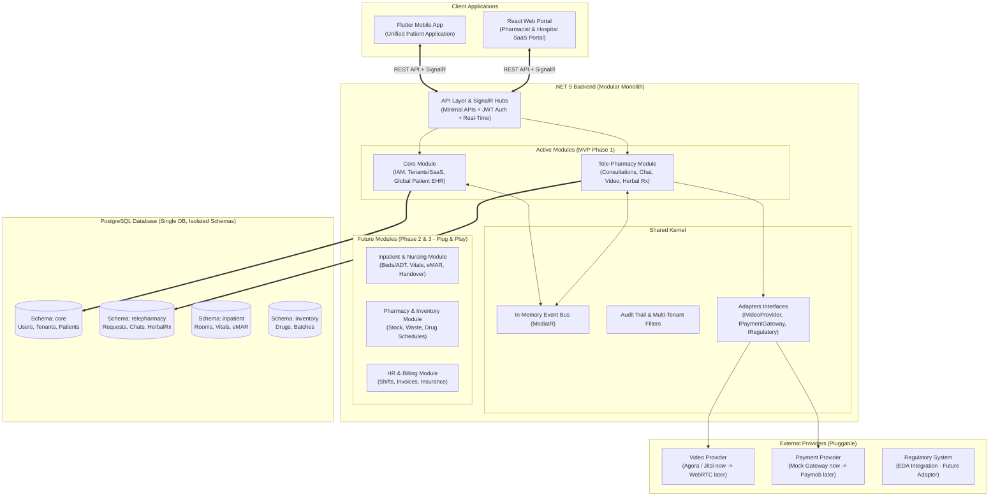
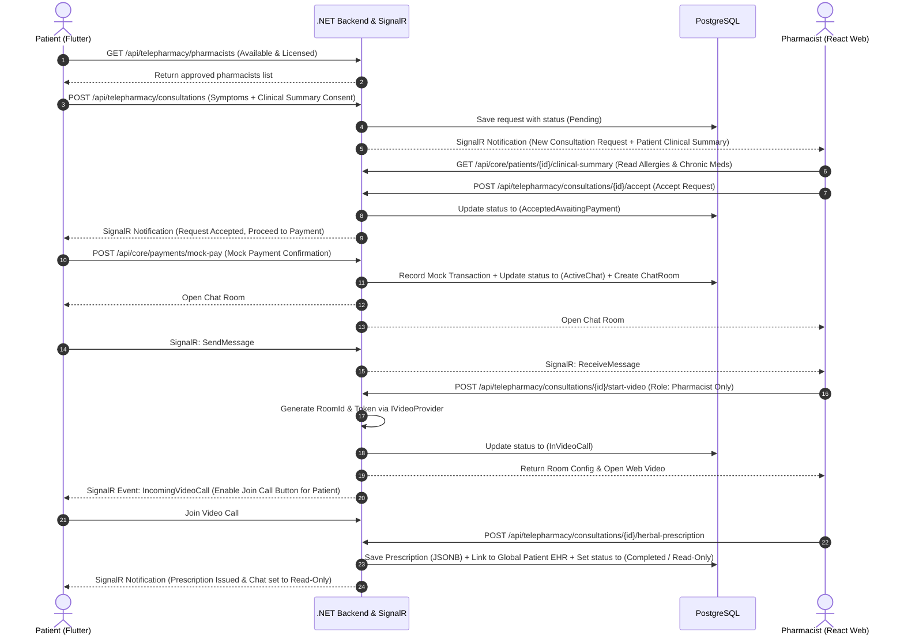
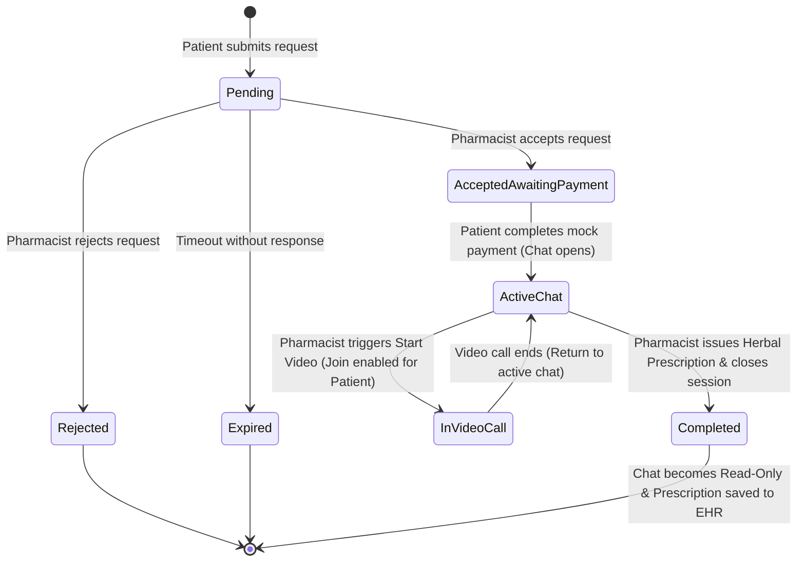
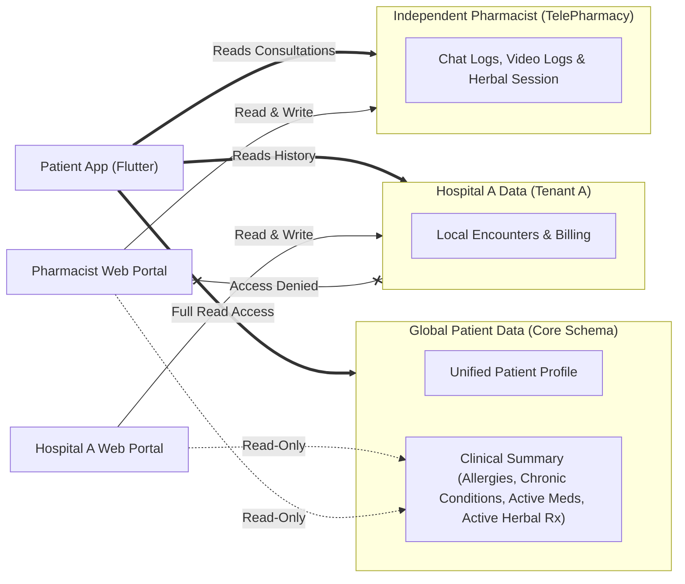

# Healthcare ERP - System Architecture & Workflows

## 1. High-Level System & Modular Monolith Architecture

## 2. Tele-Pharmacy End-to-End Sequence Flow

## 3. Consultation State Machine

## 4. Data Privacy & Multi-Tenancy Access Rules

