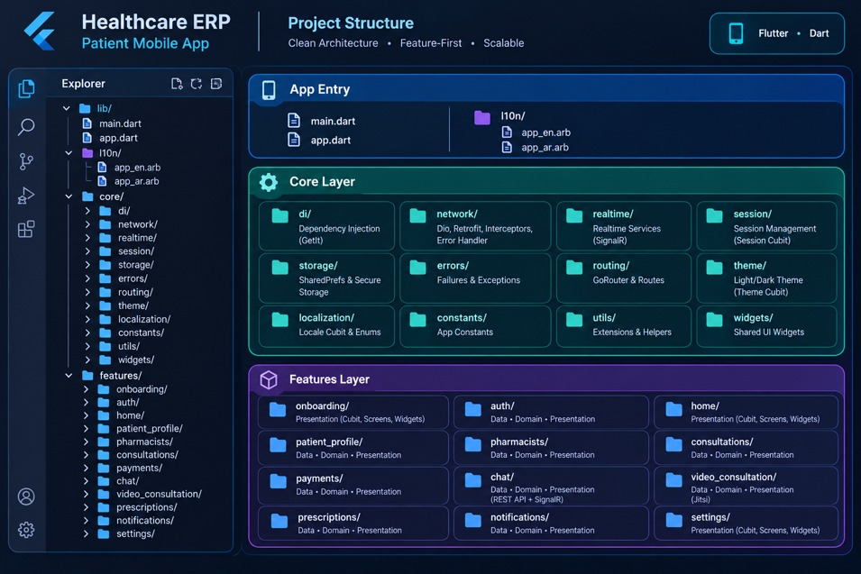

# 🏥 Healthcare ERP - Patient Mobile App

A scalable, feature-first Flutter mobile application built with **Clean Architecture** and **Cubit/BLoC** state management.

## 🏗️ Project Architecture & Folder Structure

### Key Highlights
- **Architecture:** Clean Architecture (Data, Domain, Presentation layers per feature).
- **State Management:** Flutter Bloc / Cubit.
- **Dependency Injection:** GetIt.
- **Networking & Realtime:** Dio, Retrofit, and SignalR.
- **Routing & Localization:** GoRouter & built-in ARB localization (`en` / `ar`).